Contenido

[<u>Introducción. 3</u>](#_heading=h.lhta8le3mftt)

[<u>Requisitos Previos. 4</u>](#_heading=h.hnrrassgilb3)

[<u>Instalación de java. 4</u>](#_heading=h.vn99hid2rpw0)

[<u>Windows 4</u>](#_heading=h.oi6qo0mytasd)

[<u>Configuración de variables de entorno.
7</u>](#_heading=h.iafz2l1jhdw6)

[<u>Instalación de Maven. 11</u>](#_heading=h.ygt028n53b4w)

[<u>Windows 11</u>](#_heading=h.z4v37yi2m17m)

[<u>Pasos 11</u>](#_heading=h.mv4srgifs5ng)

[<u>Instalación de Docker (Engine y Desktop).
15</u>](#_heading=h.jmf0c0kntxj0)

[<u>Windows 15</u>](#_heading=h.ufzzzeshxhvh)

[<u>Linux 17</u>](#_heading=h.rh4wvivvi2h2)

[<u>Compilación del proyecto para ejecutar en docker
17</u>](#_heading=h.ku4dmec8yjbh)

[<u>Perfiles de ejecución 17</u>](#_heading=h.l1belgga77n6)

[<u>Pasos para generar compilado del proyecto.
18</u>](#_heading=h.bcqudxpvcg2l)

# Requisitos Previos.

Para poder compilar e instalar el aplicativo en un entorno local es
necesario primero contar con un grupo de herramientas instaladas para
poder operar y procesar el aplicativo.

## Instalación de java.

### Windows

Para la versión de java que se recomienda para este aplicativo sería la
versión java 21, con el update más reciente. Al momento de la redacción
de este documento se usa la versión 21.0.3+9. Es cierto que existe una
gran variedad de distribuidores que implementan la máquina virtual de
java para esta versión, pero la que más se recomienda y se abordará en
este documento será Eclipse Temurin.

Para esto existen 2 opciones: descargarlo desde la página oficial de
Adoptium o usar una versión que se encuentra en una ruta en la red con
el entorno zippeado para solo ser descargado y colocado en una maquina
localmente.

En caso de desear usar el software que está en la carpeta de red este se
puede obtener desde la siguiente ruta:

[<u>\\172.17.10.98\sistemas\DOCTOS_SISTEMAS\Software Legacy\java\java
21\OpenJDK21U-jdk_x64_windows_hotspot_21.0.3_9.zip</u>](about:blank)

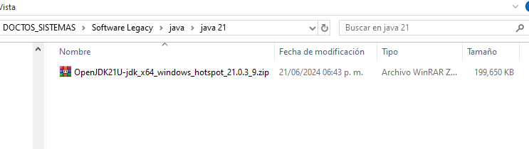

Tomar en cuenta que el archivo es la versión para Windows y ya tiene
todo el compilado del jdk para solo ser descomprimido y colocado en una
carpeta del equipo.

Para el caso que se desee bajar desde el sitio oficial de Adoptium, va a
ser necesario crear una cuenta gratuita en su portal ya que forzosamente
te piden que tengas una para poder descargar su software. La url del
portal es la siguiente:

[<u>https://adoptium.net/es/temurin/releases/</u>](https://adoptium.net/es/temurin/releases/)

Una vez en el sitio, del listado que se muestra, usamos el filtro de
“Versión” y seleccionamos la versión 21 LTS.

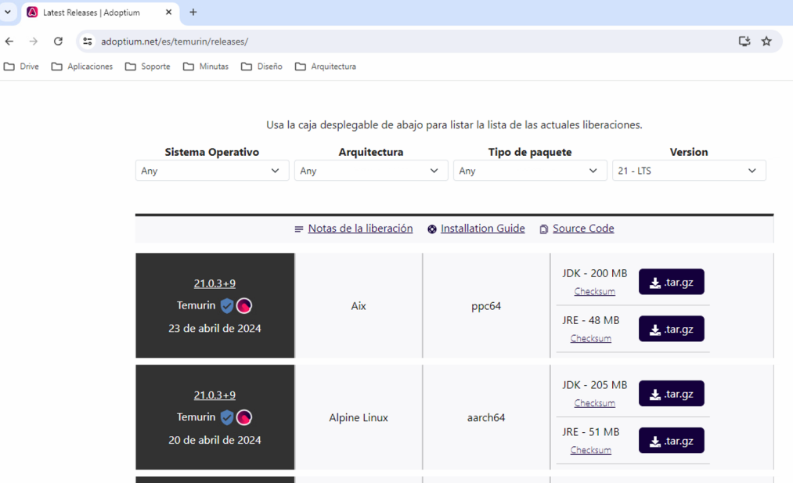

Una vez hecho eso, nos desplazamos por el listado hasta toparnos con la
versión que ocupamos o podemos afinar el filtro aún mas con los otros 3
que cuenta la página hasta dar con la plataforma para en la que deseamos
usar el SDK.

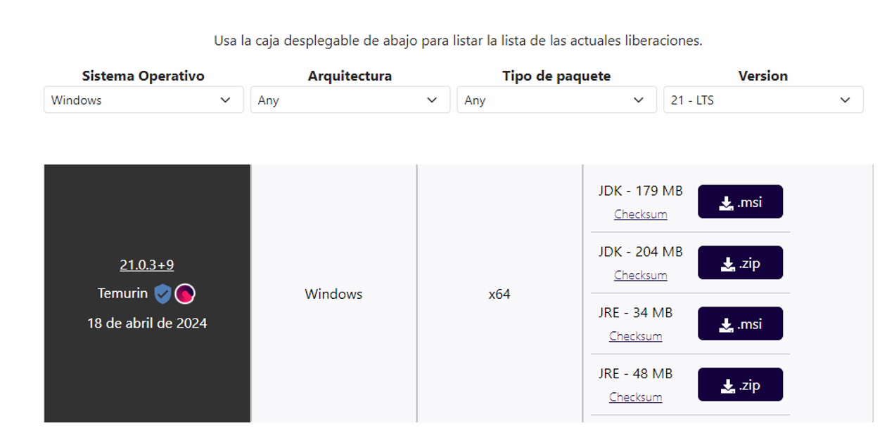

De ahí podemos escoger la versión de instalador que nos guiaría por una
serie de pantallas para configurar la versión de java en nuestro equipo
(Incluye el agregar el ejecutable de java.exe a la variable de entorno
PATH) o podemos descargar la versión completa con extensión .zip. Solo
que está ultima requiere de un par de configuraciones manuales,
relacionados a variables de entorno del sistema.

java -version

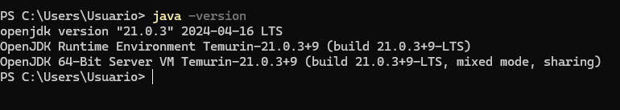

En caso de que la versión usada sea la del archivo zippeado que se
encuentra en la carpeta de red, se debe copiar en alguna ruta donde
estaría el entorno y descomprimir el contenido con algún software para
ello como 7zip o winrar.

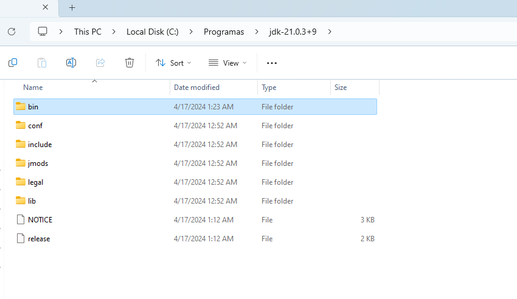

## Configuración de variables de entorno.

Una vez colocado en una carpeta accesible dentro del equipo,
procederíamos a agregar la carpeta bin del jdk a la variable de entorno
del sistema en caso de ser necesario ya que si usamos alguna versión que
traiga un instalador, este lo hace automáticamente, pero de igual forma
es lo ideal checar la variable. Para ello, desde el panel de control
podemos navegar al menú de Sistema y Seguridad

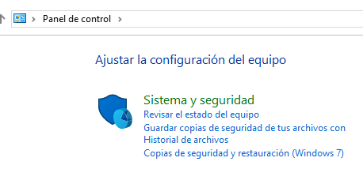

Y de ahí nos vamos al módulo de Sistema.

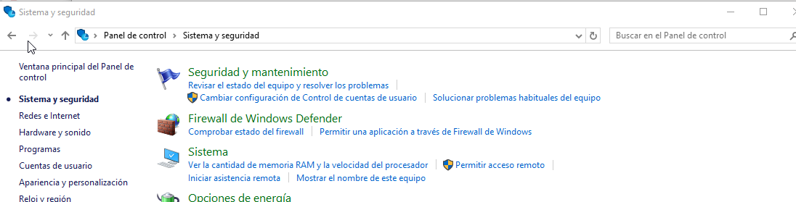

Una vez hecho clic en el botón nos enviará a una ventana llamada “Acerca
de” y del lado derecho nos desplegará un grupo de opciones, de los
cuales debemos hacer clic en la opción de “Configuración avanzada del
sistema”

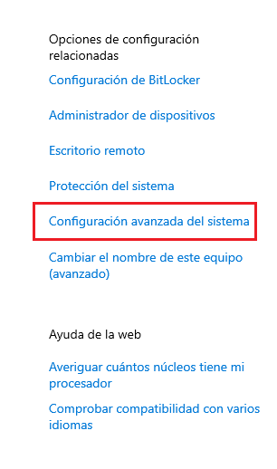

Después de ello, nos aparecerá una ventana como la que sigue y ahí
tendremos que hacer clic en el botón de “Variables de entorno”

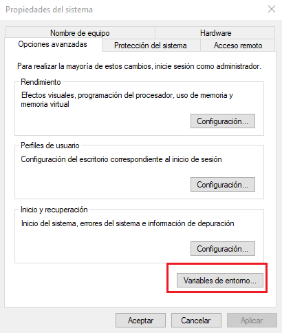

Entonces, nos aparecerá otra ventana modal adicional como la que se
puede ver en la imagen siguiente:

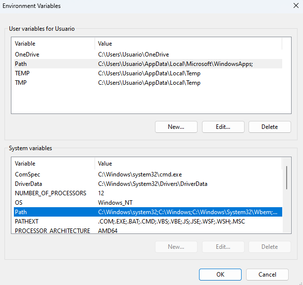

Aquí, debemos seleccionar la variable que vamos a editar que en este
caso sería “Path” y luego hacer clic en el botón de Editar en caso de
que ya exista o si es nueva, sería en el botón de “Nueva”. Al hacer esto
nos aparecerá otra ventana modal adicional donde nos enlistará todos los
valores, o en este caso, rutas asociadas a la variable de entorno “Path”

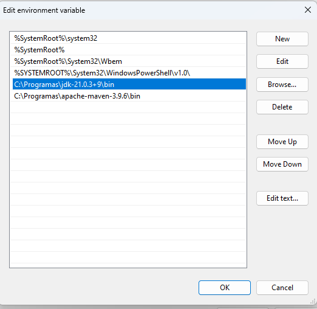

Una vez hecho clic sobre el botón indicado, hacemos otro clic en el
botón de New para agregar la ruta donde se encuentre nuestros binarios
para invocarlos desde cualquier lugar en la línea de comandos. Concluido
esto, damos clic en el botón de ok de esa ventana y de la anterior
tambien para dar por finalizado el proceso.

Para corroborar que nuestro ajuste haya quedado bien, abrimos una nueva
ventana de línea de comandos o cmd y ejecutamos el siguiente comando:

java -version

Si todos salió veremos un resultado como el de la imagen de arriba.
¡Enhorabuena! Ya tenemos nuestro entorno de desarrollo java configurado.

**NOTA**: Para otras versiones más recientes de Windows el cómo llegar a
la pantalla de configuración de variables de entorno es distinto por lo
que se puede intentar encontrar la opción en la caja de búsqueda de
Windows con la siguiente descripción: “Editar las variables de entorno
del sistema”

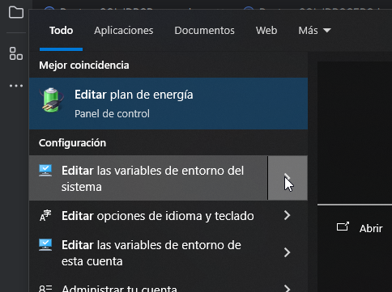

## Instalación de Maven.

### Windows

Para la instalación de maven en Windows se puede hacer descargando el
binario mas reciente encontrado en la siguiente url
([<u>https://maven.apache.org/download.cgi</u>](https://maven.apache.org/download.cgi))
o se puede descargar de una ruta en la red que se localiza en la
siguiente ruta:

\\172.17.10.98\sistemas\DOCTOS_SISTEMAS\Software Legacy\maven

De ahí, usar la versión 3.9.6 ó la más reciente de la serie 3.9.X ya
que, al momento de redactar este documento, fue la versión que se usa
para compilar el proyecto.

### Pasos

1.  Es posible descargar el ultimo binario disponible de apache Maven
    desde la url proporcionada, el cual al hacer clic en el, nos llevará
    a una página como la que se ve en la imagen a continuación:

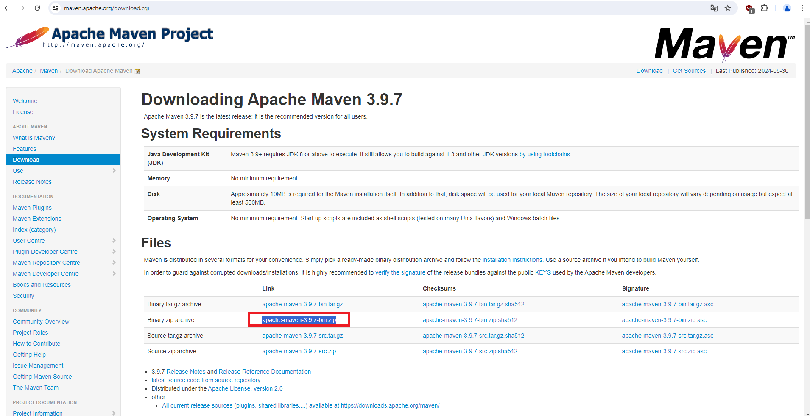

**NOTA**: Para el caso de java 1.8, no usar versiones superiores de
**maven** 3.9.X ya que es la última versión compatible con esa
plataforma.

1.  Una vez descargado el archivo en una ruta en el equipo, se procede a
    descomprimir el archivo con cualquier herramienta como winrar o 7z.

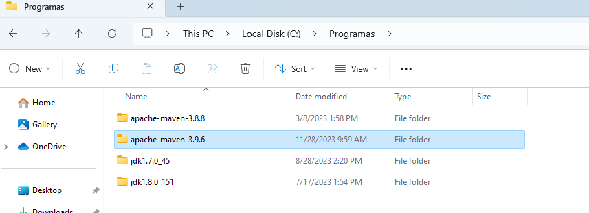

1.  Una vez hecho esto, procedemos a agregar la ruta de la carpeta bin
    del programa a la variable de entorno **PATH** del sistema operativo
    como se vio en la sección de la instalación de java:

2.  Agregamos una nueva entrada a la variable de entorno del sistema
    path con la ruta donde se encuentra el binario del aplicativo:

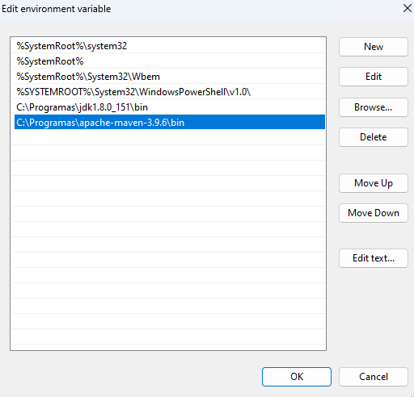

1.  Una vez hecho eso damos clic en el botón de Ok de esa ventana

2.  Para el caso de maven, es necesario definir una variable de entorno
    adicional llamada **JAVA_HOME**, ya que, para poder funcionar,
    necesita conocer donde está la ruta del entorno de desarrollo de
    java (jdk) con el que va a trabajar. Para ello, definimos una nueva
    variable en la ventana de “Variables de Entorno” como se ve a
    continuación.

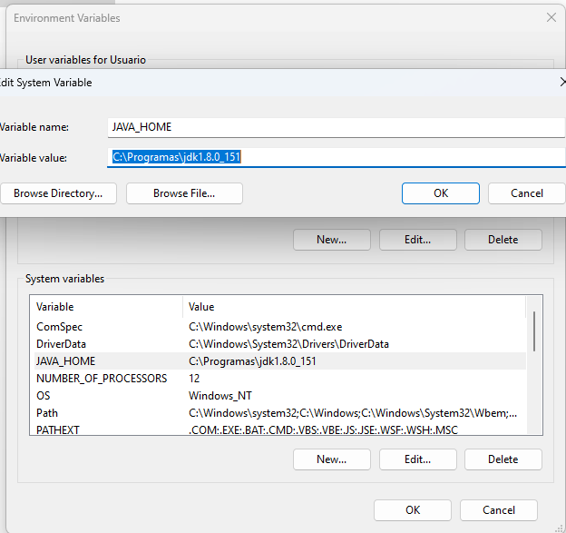

1.  Debemos definir una variable JAVA_HOME donde su valor sería la ruta
    del home del jdk como se puede ver en la imagen anterior. Una vez
    hecho esto damos ok en las dos ventanas y abrimos una línea de
    comandos para validar que toda la configuración haya quedado bien
    ejecutando el siguiente comando:

mvn -version

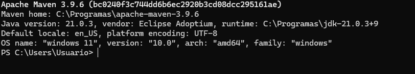

Si al ejecutar nos regresa la siguiente salida en la consola, significa
que la configuración se hizo de forma exitosa.

## Instalación de Docker (Engine y Desktop).

### Windows

1\. Para la instalación de Docker en Windows se puede instalar
aprovechando el instalador de la aplicación de Docker Desktop. Para
ello, es necesario ir a la url
siguiente([<u>https://www.docker.com/products/docker-desktop/</u>](https://www.docker.com/products/docker-desktop/))
y descargar la versión de windows

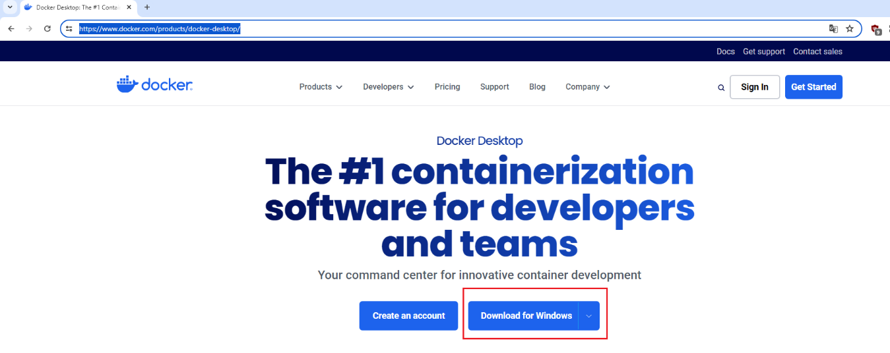

2\. Ejecutamos el instalador para iniciar con el proceso el cual debe
arrojarnos la siguiente ventana inicial

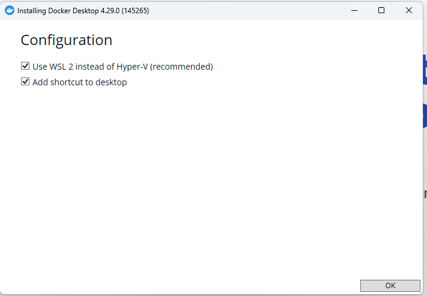

Damos clic en el boton “OK” para continuar con la instalación de la
aplicación. Veremos una ventana de progreso como la siguiente

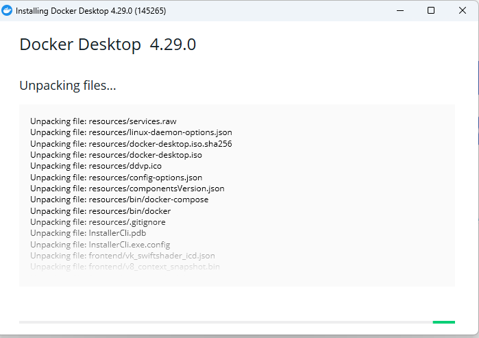

Al finalizar la instalación veremos una pantalla como la siguiente que
nos pedirá reiniciar:

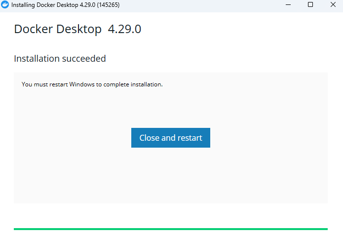

Una vez reiniciado el equipo nos aparecerá la siguiente ventana. Le
damos en “Usar los ajustes recomendados” y finalizamos con el botón
“finish”.

Al finalizar el paso anterior y que no haya salido ninguno otro mensaje,
tendremos listo nuestro sistema de Docker para empezar a trabajar como
se puede ver en la imagen siguiente:

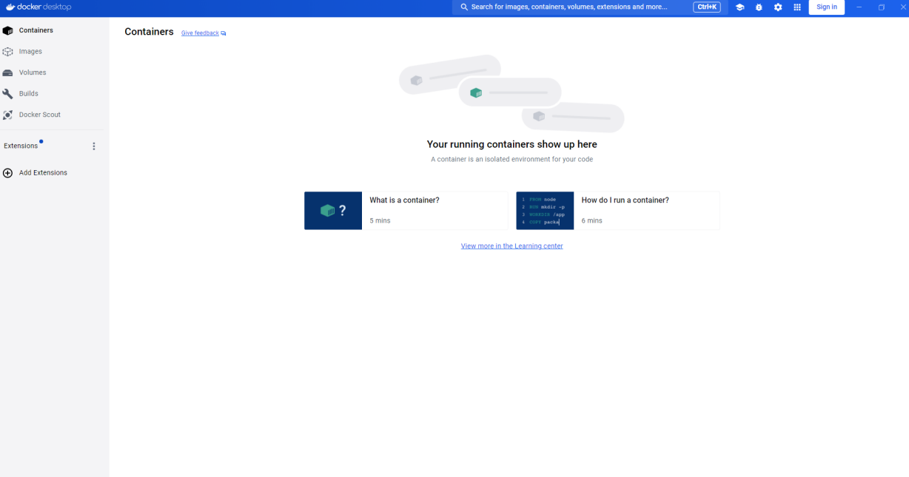

### Linux

Para la instalación de Docker Desktop mas Docker Engine en sistemas
operativos Linux, se puede usar la siguiente url para consultar los
pasos a seguir dependiendo de la distribución usada
([<u>https://docs.docker.com/engine/install/</u>](https://docs.docker.com/engine/install/)
y
[<u>https://docs.docker.com/desktop/install/linux-install/</u>](https://docs.docker.com/desktop/install/linux-install/)).

# Compilación del proyecto para ejecutar en docker.

## Perfiles de ejecución

Para este proceso se maneja un concepto de perfiles de ejecución el cual
usa el proceso para saber que archivo de properties usar para su
ejecución. Este dato debe especificarse en el momento de la compilación
de la imagen del proyecto. Actualmente está rutina cuenta con los
siguientes perfiles:

- **local**: Usado para la ejecución local en el equipo del
  desarrollador.

- **dev**: Usado para ejecutarse en un ambiente de desarrollo que no es
  la máquina del programador.

- **test**: Empleado para ejecutarse en un entorno de testing o staging.

- **prod**: Utilizado para ejecutarse en un entorno productivo.

## Pasos para generar compilado del proyecto.

Como pasos previos a considerar antes de la instalación, es el tener
instalado una versión reciente de Docker CE en el equipo local ya que
este proyecto se apoya de Docker para generar la imagen y ejecutarlo en
un contenedor. Si por alguna causa se requiere ejecutar localmente,
sería necesario tener instalado tambien una versión de java 21 y Maven
3.9.X.

1.  Descargar el repositorio en un .zip o clonarlo en tu equipo local
    con alguna de la siguientes urls dependiendo de si se tiene
    configurado el acceso por ssh o no:

**https**:

git clone
[<u>https://github.com/aspintegraopciones/asp-pago-management</u>](https://github.com/aspintegraopciones/asp-pago-management)

1.  Se puede hacer uso de cualquier editor o IDE de desarrollo que
    soporte java como Intellij, Eclipse,Visual Studio Code, entre otros
    que soporten el uso de una línea de comandos desde la misma
    aplicación para el caso en el que se tenga que hacer algún cambio.
    No olvidar cargar el proyecto como uno de maven para que las
    dependencias sean reconocidas al hacer esto. En caso de no ocupar un
    IDE y solo querer compilar el proyecto se puede usar solo la línea
    de comandos, posicionándose en el directorio donde se encuentre el
    archivo pom.xml que es el que tiene la definición de todas las
    dependencias y estrategias de compilación

2.  El proyecto tiene un archivo dockerfile en la raíz que es usado para
    la generación de la imagen del proyecto para luego ser portado o
    cargado en un servidor docker para generar un contenedor.

3.  El proyecto tambien cuenta con otro grupo de properties que usa el
    proyecto llamado **conceptos-{profile}.properties**, el cual puede
    ser modificado o usado para alojar otros valores constantes que
    pueden ser distintos en los diferentes entornos de ejecución.

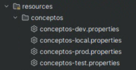

1.  El proyecto tambien cuenta con otro grupo de properties que usa el
    proyecto llamado **endpoints-{profile}.properties**, el cual puede
    ser modificado o usado para alojar urls de servicios de aplicativos
    a los que se debe conectar el microservicio que pueden ser distintos
    en los diferentes entornos de ejecución.

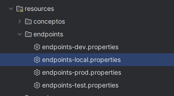

1.  Ejecutar el siguiente comando para generar la imagen del proyecto
    para docker:

**docker build -t asp-pago-management --build-arg profile=test**

Donde el valor “test” vendría siendo el perfil de ejecución usado para
la compilación y su posterior ejecución cuando se monte el contenedor.

1.  Si todo salió correctamente, la imagen aparecerá en el listado de
    docker usando el comando **docker images**

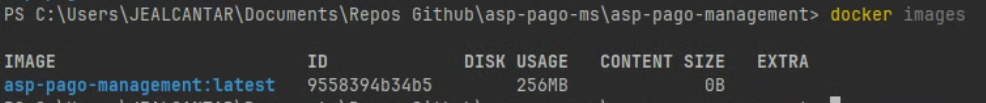

Para poder subir la imagen es necesario primero descárgalo del entorno
local en un .tar, lo cual se puede lograr con el siguiente comando, esto
nos generara él .tar en la raíz del proyecto:

**docker save -o asp-pago-management.tar asp-pago-management**

# Configuración externa del proyecto.

1.  El proyecto tiene una carpeta de configuración en la raíz del
    proyecto, el cual tiene archivos de configuración sensibles, como
    credenciales para conectarse a la base de datos, llaves de cifrado o
    credenciales para consumir aplicativos externos o de la misma red de
    ASP, estos archivos se pueden modificar aun después de generar la
    imagen del contenedor.

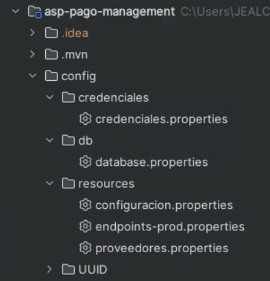

**Carpeta credenciales.**

Dentro de la carpeta credenciales existe un archivo
**credenciales.properties**

1.  **credenciales.properties:** es quien almacena las credenciales para
    consumir otros aplicativos, así como llaves de cifrado. Se debe
    tener en cuenta que las credenciales pueden ser distintos en los
    diferentes entornos de ejecución.

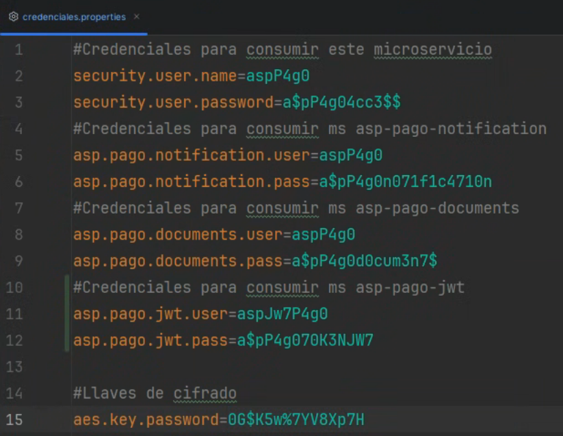

**Carpeta db.**

1.  **database.properties:** en este archivo se coloca la configuración
    de base de datos.

\*\*\
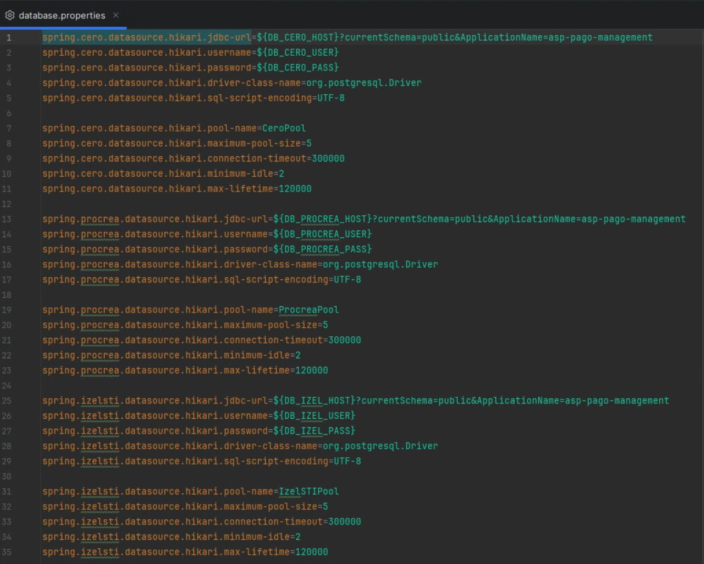\
\*\*

Los datos que componen cada una de las conexiones que se usan en el
proyecto (procrea y cero) son la siguientes:

- **jdbc-url**: Contiene la url de conexión a la base de datos compuesto
  de 3 datos: el host donde se encuentra la BD, el puerto de conexión y
  la base de datos. El formato sería el siguiente:
  **jdbc:postgresql://{host}:{puerto}/{basedatos}**

- **username**: Nombre del usuario para autenticarse al momento de
  conectarse a la BD

- **password**: Contraseña que, en conjunto con el username, son usados
  para autenticarse al momento de conectarse a la BD.

- **driver-class-name**: Nombre de la clase del driver usado para
  conectarse a la BD. Esto por lo general no se cambia y se mantiene
  igual

- **sql-script-encoding**: Representa la codificación de la ejecución de
  los queries. Esto no se mueve.

Existe otro grupo de datos que es posible mover dependiendo de las
necesidades que existan del aplicativo o de la infraestructura que son
los siguientes:

- **pool-name**: Es un nombre representativo para el pool de conexiones
  declarado.

- **maximum-pool-size**: Maneja el máximo de conexiones hasta donde
  pueda crecer un pool, dependiendo de la demanda

- **connection-timeout**: Es la cantidad en ms del tiempo el cual el
  pool puede esperar hasta poder obtener una nueva conexión en caso de
  que todos estén ocupados.

- **minimum-idle**: Maneja la cantidad de conexiones mínimas que pueden
  quedar establecidas para no tener que repetir el proceso de obtención
  de nuevas y se puedan atender la solicitud de consultas de forma más
  rápida.

- **idleTimeout**: Indica el tiempo, en ms, que una conexión siempre y
  cuando el número de conexiones idle sea mayor al establecido en el
  parámetro mínimum-idle en el momento, pueden quedar sin hacer nada
  antes de ser cerradas.

- **maxLifetime**: Es el tiempo en ms que debe pasar para que una
  conexión sea renovada, es decir, cerrada y volver a abrir con el fin
  de evitar que las conexiones se mantengan por tiempos muy prolongados,
  incluso si son las que se encuentran en estado idle o sin hacer nada.

Como se puede observar el archivo **database.properties** hace uso de
variables de entorno, las cuales están configurardas en un archivo
.**env**.

Este archivo **.env** viene en la raíz del proyecto con el nombre
**.env.management**

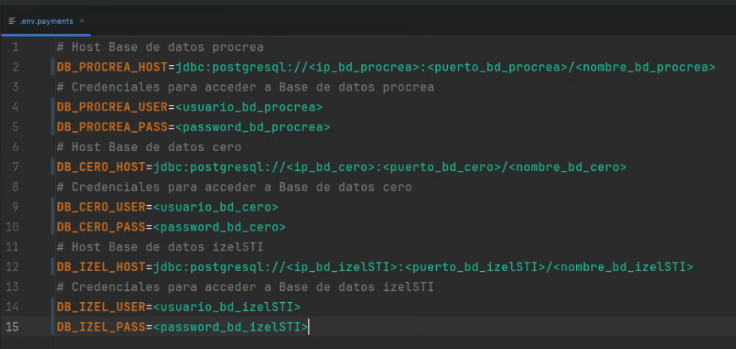

Aquí se necesitan modificar los valores por sus respectivos valores
productivos, tanto para usuarios, como ips, puertos y nombre de la base
de datos.

**Carpeta resources.**

Dentro de la carpeta resources existen 3 archivos.

1.  **configuracion.properties:** En este archivo vienen variables que
    pueden ser modificadas en un futuro para no tener que recompilar la
    imagen del contenedor, simplemente basta con editar el valor en el
    archivo properites del servidor, detener y levantar el contenedor.

2.  **endpoints-prod.properties:** en este archivo se colocan los
    endpoints que serán consumidos en ambiente productivo.

El proyecto cuenta con un apartado de endpoints por perfil dentro del
compilado de la imagen para los perfiles **test, local y dev**. En el
caso del ambiente **prod**, este archivo es un archivo externo, esto
para que al momento de su **liberación** a **producción** sea más fácil
para **infraestructura** cambiar las **ips**, **puertos** sin tanto
problema, y en caso de colocar algo erróneo, bastaría con modificar el
archivo del servidor sin necesidad de volver a compilar la imagen.

1.  **proveedores.properties:** en este archivo se coloca configuración
    de los proveedores. Se puede cambiar el tipo de envio de códigos de
    verificación de SMS a Whatsapp.

**Carpeta UUID.**

Dentro de la carpeta UUID existen 3 archivos.

1.  **suffixes.yml:** Este archivo almacena los suffixes de los
    contenedores que conforman el ecosistema de la ASP Pago que puede
    traer el UUID que puede traer el UUID al momento de consumir este
    aplicativo.

\*\*\
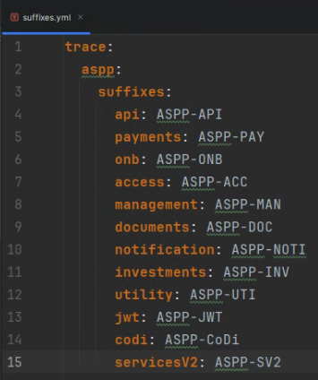\*\*

1.  **suffixes-canales.yml:** Este archivo almacena los suffixes de
    canales externos que puede traer el UUID al momento de consumir este
    aplicativo.

\*\*\
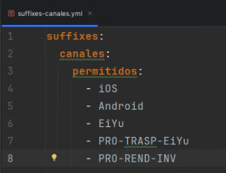\*\*

1.  **uuid.properties:** Este archivo almacena properties del UUID, aquí
    se almacena la llave secreta con el que se firma el UUID en
    **secret.key.uuid** (considerar ser cambiada en ambiente **prod**).

\*\*\
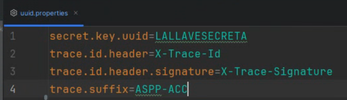\*\*

Considerar que si esta llave es cambiada, también debe ser cambiada en
los demás contenedores de la ASP Pago.

La carpeta **/config** se coloca en el servidor, ya que no forma parte
del compilado de la imagen, por lo que los archivos que lee son los que
están en el servidor, ya que se realiza un **bind mount** entre el
directorio del servidor y el contenedor.

**Configuración archivo .env.** (este es un env global que se usa para
todos los contenedores que forman parte del ecosistema de la ASP Pago, a
excepción de asp-pago-api)

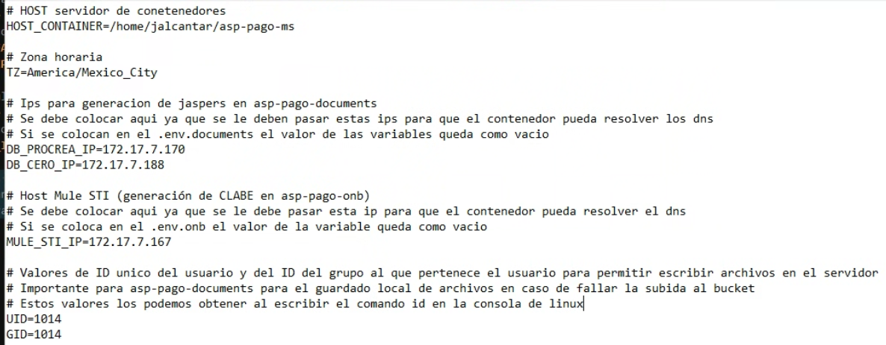

La variable **\${HOST_CONTAINER}** es en donde se encuentra nuestros
archivos de configuración, (.env, docker-compose.yml), en este ejemplo
se está utilizando la ruta **/home/jalcantar/asp-pago-ms** que se
encuentra en el servidor 172.17.7.164.

**Configuración docker-compse-yml.**

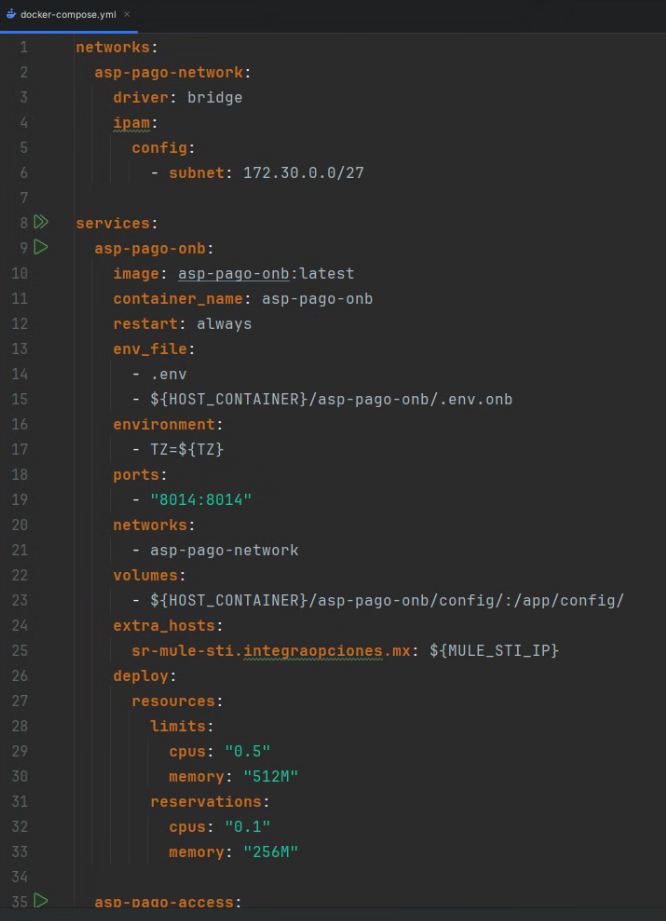

Podemos observar que se crea una red interna para los contenedores, con
el nombre **asp-pago-network** utilizando el segmento de redes
**172.30.0.0/27**, este segmento debe validarse con **infraestructura**
para no tomar **IPs** aleatorias y no tomar algún segemento o rango de
**IPs** ya ocupado.

Este docker compose es compartido por todos los contenedores que
conforman el ecosistema de la ASP Pago.

- asp-pago-onb

- asp-pago-access

- asp-pago-payments

- asp-pago-management

- asp-pago-documents

- asp-pago-notification

- asp-pago-codi

- asp-pago-investments

- asp-pago-services-v2

- asp-pago-jwt

# Ejecución del proyecto.

1.  Verificar que exista la ruta configurada en el .env en la variable
    **\${HOST_CONTAINER},** en este caso el valor es
    **/home/jalcantar/asp-pago-ms.**

2.  Copiar el archivo **docker-compose.yml,** archivo **.env** y
    colocarlos en **\${HOST_CONTAINER}.**

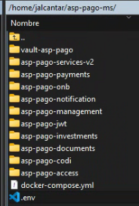

1.  Dentro de **\${HOST_CONTAINER}** crear la carpeta
    **asp-pago-management** y dentro de ella colocar el **.tar**,
    carpeta **/config** y archivo **.env.management**.

2.  Nos debe quedar la siguiente estructura. Donde
    **\${HOST_CONTAINER}** tiene actualmente el valor de
    **/home/jalcantar/asp-pago-ms** en el archivo **.env** de ejemplo.

/home/jalcantar/asp-pago-ms

│── asp-pago-management/

│ └── config/

│ └── db/

│ └── credenciales/

│ └── resources/

│ └── UUID/

│ └── .env.management

│── .env

│── docker-compose.yml

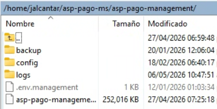

1.  Abrimos una consola de comandos en el servidor de contenedores.

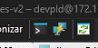

1.  Ejecutar el siguiente comando para ver si hay un contenedor de
    nuestro microservicio andando, en caso de que no, ignorar y saltar
    hasta el paso **10**:

**docker ps \| grep asp-pago-management**

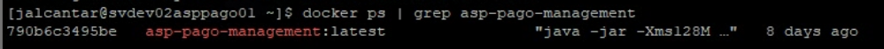

En caso de que este un contenedor de nuestro microservicio corriendo
haremos lo siguiente:

1.  Debemos navegar a la ruta de nuestro docker compose y ejecutar este
    comando, esto detendrá el contenedor y lo eliminará.

**cd /home/jalcantar/asp-pago-ms**

Para detener el contenedor:

**docker compose stop asp-pago-management**

Para eliminar el contenedor:

**docker compose rm -f asp-pago-management**

1.  Buscamos la imagen para borrarla.

**docker images \| grep asp-pago-management**

1.  Borramos la imagen con el siguiente comando.

**docker rmi \<id_imagen\>**

1.  Una vez dentro de la **/home/jalcantar/asp-pago-ms**, navegamos
    hacia la carpeta **/asp-pago-management** y cargamos la imagen
    subida al servidor de contenedores con el siguiente comando:

**docker load -i asp-pago-management.tar**

1.  Una vez que la imagen se haya cargado, utilizamos el siguiente
    comando para correr un contenedor de Docker.

**docker compose up -d asp-pago-management**

1.  En caso de desear consultar los logs directamente desde el servidor
    en tiempo de ejecución, se puede usar el siguiente comando para
    ello.

**docker logs -f --tail 1000 asp-pago-management**

1.  Para validar el bind mount utilizamos el siguiente comando.

**docker exec -it asp-pago-management ls /app/config**

# Configuraciones extra.

El contenedor debe poder comunicarse con los siguientes servicios.

1.  Salida a internet.

El contenedor debe poder comunicarse con las siguientes bases de datos.

1.  procrea

2.  cero

3.  izelSTI
